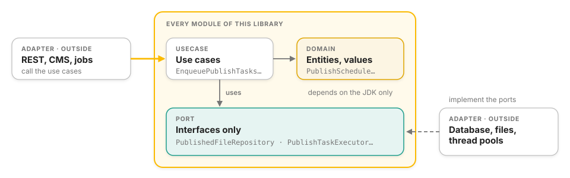

# IES Publisher Core

The core library of the IES Publisher: the domain model and the use cases behind publishing,
link checking, channels and translation statistics.

The Publisher component of the IES compiles data from a resource with the help of aggregators and
writes it as files to the file system, where the web server picks it up for the website. This
library holds the business rules of that process. It contains **no infrastructure**: databases,
thread pools and the code that writes files are reached through ports, which adapter modules
outside this repository implement.

## Modules

| Module | Artifact | What it does |
|---|---|---|
| `publishing` | `ies-publisher-core-publishing` | Schedules publishing in the background and the foreground, keeps track of the published files and URL mappings of every entity. |
| `linkchecker` | `ies-publisher-core-linkchecker` | Collects the external links of published resources and checks them at regular intervals; editors see the results in the CMS. |
| `channel` | `ies-publisher-core-channel` | Provides information about the available publishing channels. |
| `translation` | `ies-publisher-core-translation` | Statistics about the texts translated automatically during publishing. |

All artifacts share the group id `com.sitepark.ies`. A module is used by depending on it:

```xml
<dependency>
  <groupId>com.sitepark.ies</groupId>
  <artifactId>ies-publisher-core-publishing</artifactId>
  <version>${ies-publisher-core.version}</version>
</dependency>
```

## Architecture

Each module follows the **hexagonal architecture** (ports and adapters) and is a Java module of
its own (`module-info.java`):



- **Use cases** (`usecase/`) are the entry points: one class per use case, wired with
  `jakarta.inject` (`@Inject`), e.g. `EnqueuePublishTasks`, `BackgroundLinkCheck`.
- **Domain** (`domain/`) holds immutable entities and values (records), and domain services such as
  `PublishSchedule`. It depends on nothing but the JDK.
- **Ports** (`port/`) are plain interfaces, e.g. `PublishedFileRepository` or
  `PublishTaskExecutor`. They are never implemented here.

Null safety is part of the API: every module is `@NullMarked` (JSpecify), so only values marked
`@Nullable` may be `null`.

## Documentation

- [How publishing is scheduled](doc/publish-schedule.md): `PublishSchedule` explained step by
  step, with diagrams. Start here before changing anything in the publishing schedule.
- The Javadoc of each use case says what it does and who may call it.

## Building

Requires **JDK 25** and Maven.

```bash
mvn clean verify          # build, test, and run all checks
mvn spotless:apply        # format the code (Google Java Style)
mvn test -pl publishing   # test one module
mvn test -pl publishing -Dtest=PublishScheduleOrderTest
```

`mvn verify` fails on any of these findings:

| Check | Tool |
|---|---|
| Formatting | Spotless with google-java-format |
| Bugs and null safety | Error Prone with NullAway (JSpecify mode) |
| Static analysis | PMD 7 with `pmd-ruleset.xml` |

Test coverage is reported by JaCoCo (`mvn jacoco:report`, see `target/site/jacoco/`).

## Contributing

- Branches: `main` is the next major version (2.x), `support/1.x` the maintenance line of 1.x.
  Work on a feature branch and open a pull request; GitHub Actions verify every branch.
- Commit messages follow [Conventional Commits](https://www.conventionalcommits.org/). The hook in
  `.githooks/` checks them; enable it once with `git config core.hooksPath .githooks`.
- Run `mvn spotless:apply` before committing.

## License

[MIT](LICENSE.md) © Sitepark GmbH
