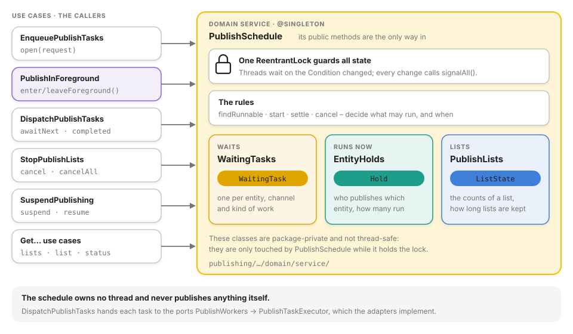
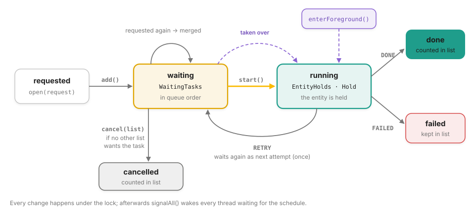
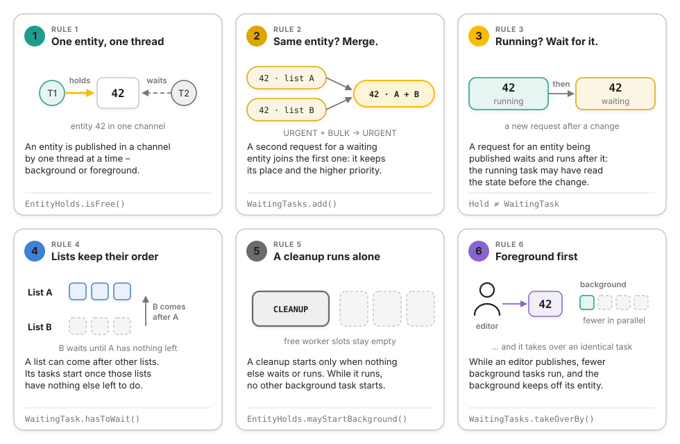
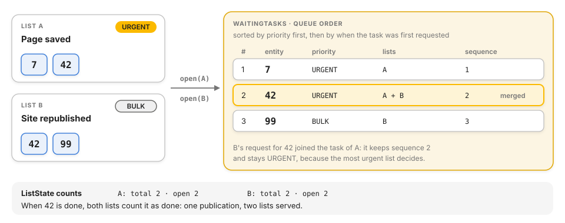
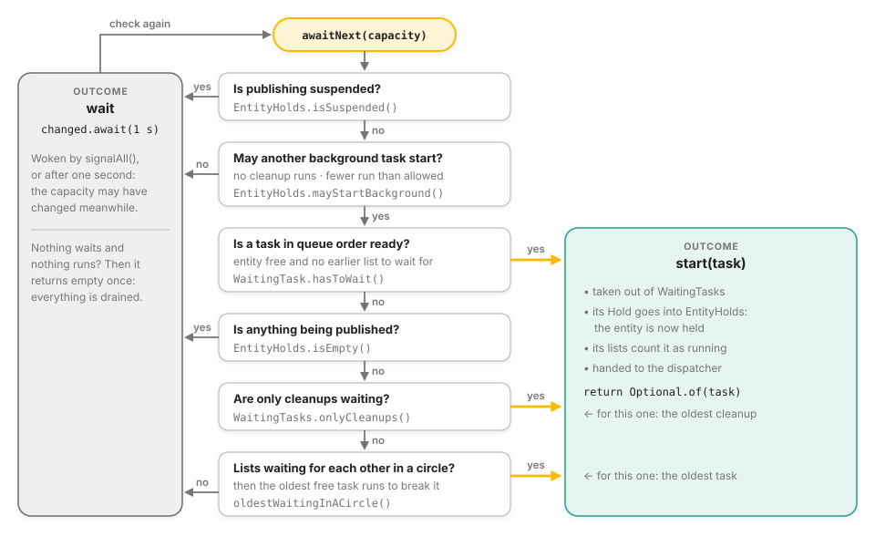
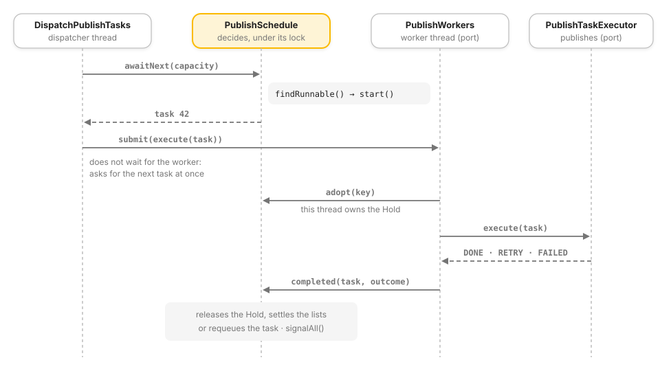
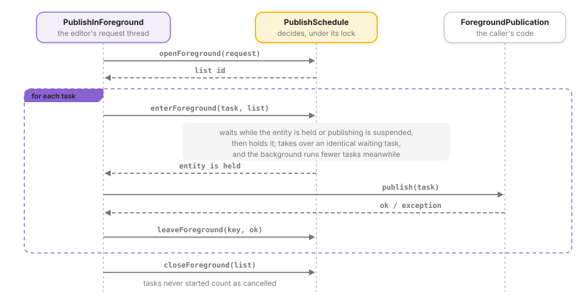

# How publishing is scheduled

This guide explains `PublishSchedule`, the class that decides **what is published when**. You do
not need to know the publisher to follow it. After reading it you should be able to answer three
questions:

1. Why does a task start now, or why doesn't it?
2. What happens when two people want the same thing published?
3. Where in the code do I look when something behaves oddly?

Plan for about 20 minutes. Every section points to the class or method it describes. Have the
code open next to the guide: `publishing/src/main/java/.../publishing/domain/service/`.

---

## 1. The problem in one paragraph

Many things want to publish at the same time. An editor saves a page and wants it online *now*.
A change to a navigation means 300 linked pages have to follow. An admin republishes a whole
site overnight. All of this runs on a few worker threads, and it must stay **correct**: no page
may be written by two threads at once, a newer change must never be overwritten by an older run,
and the editor should not wait behind the overnight job. `PublishSchedule` is the one place that
knows all the requests and decides the order.

## 2. The big picture



Remember three things:

- **Use cases are the only callers.** `EnqueuePublishTasks`, `PublishInForeground`,
  `DispatchPublishTasks` and the others all get the same `@Singleton` instance injected.
- **The schedule never publishes anything.** It has no thread of its own. It only *decides* and
  *makes threads wait*. The real work is done by the ports `PublishWorkers` (a thread pool) and
  `PublishTaskExecutor` (the code that writes files), which live in the adapters.
- **All state sits behind one lock.** `PublishSchedule` keeps the rules. The state lives in three
  helper classes: `WaitingTasks`, `EntityHolds` and `PublishLists`. They are package-private and
  not thread-safe, which is fine because they are only touched while the lock is held
  (see [section 9](#9-inside-the-class-one-lock-one-condition)).

## 3. Vocabulary

| Term | Meaning | In the code |
|---|---|---|
| **Entity** | Something that can be published, e.g. a page, in one channel. | `PublishTaskKey(channelId, entityId)` |
| **Task** | One piece of work for an entity: publish, depublish (revoke), translate or clean up. | `PublishTask`, `PublishTaskType` |
| **List** | A group of tasks requested together, such as "page saved" or "republish site". Has a name, a priority and an id you can watch, await and cancel. | request: `PublishListRequest`, state: `ListState`, snapshot for callers: `PublishList` |
| **Priority** | `URGENT` › `NORMAL` › `BULK`. Belongs to the list, and its tasks inherit it. | `PublishPriority` |
| **Waiting task** | A task that is not running yet. There is at most one per entity and kind of work. | `WaitingTask` in `WaitingTasks` |
| **Hold** | "This entity is being published right now, by this thread." | `Hold` in `EntityHolds` |
| **Background** | Tasks handed to worker threads by the dispatcher. | `awaitNext()`, `completed()` |
| **Foreground** | An editor's own request thread publishes, and waits for the result. | `enterForeground()`, `leaveForeground()` |
| **Capacity** | How many background tasks may run in parallel, normally and while the foreground publishes. | `PublishingCapacity(parallel, parallelWhileInteractive)` |

> **"Kind of work" in detail:** publish and depublish share one place (`Slot.CONTENT`), because a
> later depublish replaces an earlier publish. Translation and cleanup have places of their own,
> so an entity can have a content task *and* a translation task waiting at the same time. Even
> then, they never *run* at the same time, because a hold is per entity.

## 4. The life of a task



Each box is a state, each arrow a method of `PublishSchedule` or of the helper class it delegates
to.

1. **requested → waiting:** `open(request)` registers the list and puts every task into
   `WaitingTasks` via `add()`. Nothing is handed out before all tasks of the list are known.
2. **waiting → running:** the dispatcher asks `awaitNext()`. When a task may run, `start()` takes
   it out of `WaitingTasks` and puts a `Hold` into `EntityHolds`. From then on the entity is
   *held*.
3. **running → done / failed:** the worker reports `completed(task, outcome)`. The hold is
   released and every list that asked for the task counts it (`ListState.taskEnded()`).
4. **RETRY:** if the executor says the error was temporary, the task goes back to waiting as its
   next attempt, but only once (`MAX_RETRIES = 1`).
5. **cancelled:** `cancel(list)` drops waiting tasks, unless another list still wants them. A
   running task is always finished.

Two shortcuts:

- **merged:** a task requested again while it waits does not wait twice (rule 2 below).
- **taken over:** a foreground publication can do a waiting task's work (rule 6 below).

## 5. The six rules



Every rule exists to prevent a concrete bug:

| # | Rule | What would go wrong without it |
|---|---|---|
| 1 | One thread per entity and channel | Two threads write the same files, and the result is garbage. |
| 2 | Same entity waiting? Merge. | The site job and an editor both publish page 42, and it runs twice for nothing. |
| 3 | Entity running? The new request waits. | The running task read the page *before* the editor's change. If we dropped the new request, the old state would stay online. |
| 4 | A list may come *after* other lists | Pages linking to a moved page would be published with the old URL. |
| 5 | A cleanup runs alone | A cleanup deletes files that are no longer needed, and must not race with a task that is writing them. |
| 6 | The foreground comes first | The editor would wait behind a site job. So: fewer background tasks run in parallel, the background keeps off the entity the editor waits for, and an identical waiting task is done by the editor right away. |

### Merging, worked through



What happens in the example:

- The merged task **keeps its place** (sequence 2). Merging never moves a task back.
- It is **as urgent as the most urgent list** that wants it (`WaitingTask.reprioritize()`).
- It asks for **everything either request asked for**: options are merged, and the younger
  request decides between publish and depublish (`WaitingTasks.merge()`).
- Each list counts it **once**: `total` and `open` go up by one for A and for B.

> **A side effect of merging:** if B comes after A, and 42 belongs to both, then 42 is a task of
> A that B would have to wait for, and also a task of B. Lists can end up waiting for each other
> in a circle. The schedule detects that nothing can run and nothing is running, and starts the
> oldest task of the circle (`oldestWaitingInACircle()`).

## 6. Picking the next background task

This is the heart of the schedule: `findRunnable()`, called by `awaitNext()` and `pollNext()`.



Read it top to bottom. The first question answered with "go" wins. `pollNext()` takes the same
path but returns empty instead of waiting. Some details:

- **Queue order** means by priority, then by when the task was first requested
  (`WaitingTasks.inOrder()`).
- **"Entity free"** means not held, and no foreground thread waiting for it
  (`EntityHolds.isFree()`). That's why a waiting editor goes before the background.
- **"No earlier list to wait for"** (`WaitingTask.hasToWait()`): a list this task comes after still
  has other tasks open. Cleanups of that list don't count, since they run last anyway.
- **Waiting is never busy:** the thread sleeps on `changed.await(1 s)`. Every state change calls
  `signalAll()`, and the one-second timeout exists only because the capacity can change without
  anyone telling the schedule.

## 7. A background task, step by step



Two threads take part: the dispatcher and a worker. The schedule has no thread of its own; its
code runs in the thread that calls it.

The code is short. Read `DispatchPublishTasks` alongside the diagram:

```java
public void dispatchNext() throws InterruptedException {
  Optional<PublishTask> next = this.schedule.awaitNext(this::capacity); // blocks
  if (next.isEmpty()) {
    this.listener.drained();       // told once when everything is done
    return;
  }
  this.workers.submit(() -> this.execute(next.get())); // does not wait
}

private void execute(PublishTask task) {
  this.schedule.adopt(task.key()); // "this worker thread owns the hold"
  PublishOutcome outcome = PublishOutcome.FAILED;
  try {
    outcome = this.executor.execute(task);
  } finally {
    this.schedule.completed(task, outcome); // always, or the entity stays held forever
  }
}
```

Why `adopt()`? A task may publish another entity in the foreground from within, or even the
same one. The schedule must recognise the worker thread as the owner, or the thread would wait
for itself.

## 8. A foreground publication



`PublishInForeground` is used when an editor wants the result immediately. Things to notice:

- `enterForeground()` **blocks** until the entity is free. While it waits, the background will not
  start that entity (rule 6).
- **Takeover:** if a task for the same entity waits and asks for no more than the foreground does
  (same type, options included, same attachment, and not waiting for another list), the
  foreground does it instead. Its lists are counted with the foreground's result
  (`WaitingTasks.takeOverBy()`, `WaitingTask.isCoveredBy()`). Anything else, for example a
  waiting *depublish*, stays and runs afterwards. An extra run is harmless; a lost change is not.
- **Nesting:** a thread that already holds the entity may enter it again. `Hold.depth` counts the
  levels, and only the outermost `leaveForeground()` releases the entity.
- Always pair `enterForeground()` with `leaveForeground()` in a `finally`, just like a lock.

## 9. Inside the class: one lock, one condition

Every public method of `PublishSchedule` looks like this:

```java
this.lock.lock();
try {
  // 1. read or change the state (WaitingTasks, EntityHolds, PublishLists)
  // 2. if something changed that others may wait for:
  this.changed.signalAll();
} finally {
  this.lock.unlock();
}
```

Methods that have to wait loop on the condition, because a thread can wake up without its
condition being true:

```java
while (this.holds.isHeld(key) || this.holds.isSuspendedFor(thread)) {
  this.changed.awaitUninterruptibly(); // releases the lock while sleeping
}
```

This is the classic *monitor* pattern. It explains the design of the helper classes:

| Class | Keeps | Why it need not be thread-safe |
|---|---|---|
| `WaitingTasks` | waiting tasks by entity, the queue order, the cleanups | only called under the lock |
| `EntityHolds` | holds, waiting foreground threads, suspensions, how many run | only called under the lock |
| `PublishLists` | lists going on and over, ids, retention | only called under the lock |
| `ListState`, `WaitingTask`, `Hold` | the data of one list, task or publication | only reachable through the three above |

The lock is **never held while anything is published**. Publishing takes seconds, and deciding
takes microseconds.

## 10. Lists in a nutshell

- `open(request)` → id. `await(id)` blocks until the list is over. `list(id)` and `lists()`
  return snapshots (`PublishList`) with the counts `total`, `waiting`, `running`, `done`,
  `failed`, `cancelled`.
- A list is **over** when no task of it is waiting or running (`ListState.isOver()`).
  `PublishLists.finishIfOver()` then moves it to the lists that are over, without its tasks.
- Lists that are over are kept for a while, by default the youngest 20 for at most 24 hours
  (`PublishListRetentionSetting`, set with `retain()`; adapters call
  `InitPublishSchedule.init()` at startup).
- `cancel(id)` and `cancelAll()` drop waiting tasks; `suspend()` and `resume()` pause everything,
  for example during a deployment.

## 11. Where to look

| Question | Start here |
|---|---|
| Why doesn't my task start? | `PublishSchedule.findRunnable()`, then `WaitingTask.hasToWait()` and `EntityHolds.isFree()` |
| How does merging work? | `WaitingTasks.add()` and `merge()` |
| What happens on RETRY? | `PublishSchedule.completed()` → `WaitingTasks.requeue()` |
| When is a list over? | `ListState`, `PublishLists.finishIfOver()` |
| How many tasks may run? | `EntityHolds.mayStartBackground()`, `PublishingCapacity` |
| What does the foreground take over? | `WaitingTasks.takeOverBy()`, `WaitingTask.isCoveredBy()` |

The **tests are the best specification**. Their names read like rules, for example
`publishesAnEntityAgainThatWasRequestedWhileItRan` or `waitingForegroundGoesBeforeTheBackground`:

| Test class | Covers |
|---|---|
| `PublishScheduleOrderTest` | priority, merging, entity exclusivity, list order, cleanups |
| `PublishScheduleForegroundTest` | foreground waiting, takeover, nesting, capacity while interactive |
| `PublishScheduleListsTest` | list ids, counts, retention, await, cancel |
| `PublishScheduleFailureAndSuspendTest` | retry, failures, drained, suspend and resume |

## 12. Checklist: "My task does not start"

Go through these in order. They follow the flowchart in section 6.

1. Is publishing **suspended**? → `status().suspended()`
2. Is a **cleanup** running, or is the **capacity** used up (watch out: it is lower while an
   editor publishes)?
3. Is the **entity held**, or is a **foreground thread waiting** for it?
4. Does its list come **after** a list that still has open tasks?
5. Is it a **cleanup**? Then it waits until *nothing* else waits or runs.

If lists wait for each other in a circle and nothing is running, the schedule starts the oldest
free task anyway. Only a task that comes after a *foreground* list is left alone, because the
editor's thread is still working on that list. So if a task waits forever while the workers are
idle and no foreground list is open, you have found a bug.
